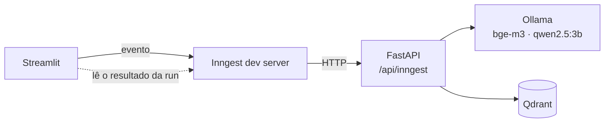

<div align="center">

# rag-orchestration

**Pergunte aos seus PDFs, com cada etapa visível no painel do Inngest.**

[](https://www.python.org/)
[](https://docs.astral.sh/uv/)
[](https://www.inngest.com/)
[](https://qdrant.tech/)
[](https://ollama.com/)
[](https://streamlit.io/)
[](LICENSE)

[Como funciona](#como-funciona) · [Começando](#começando) · [Configuração](#configuração) · [Robustez](#robustez) · [Testes](#testes)

</div>

Pipeline RAG (Retrieval-Augmented Generation) para PDFs. Você envia um arquivo, faz perguntas sobre ele e recebe a resposta com as páginas usadas como fonte.

A ingestão e a pergunta são funções do [Inngest](https://www.inngest.com/), e cada chamada ao Ollama ou ao Qdrant roda em uma etapa (`step.run`). Se uma etapa falha, o Inngest repete só ela. O painel mostra a entrada, a saída e o tempo de cada etapa.

Os modelos rodam no [Ollama](https://ollama.com/), na sua máquina. Não há chamada a API paga.

## O que tem aqui

- Ingestão por página com [LlamaIndex](https://www.llamaindex.ai/), para que cada resposta cite arquivo e página.
- Busca por similaridade no [Qdrant](https://qdrant.tech/), com um limiar mínimo que descarta perguntas sem relação com os documentos.
- Retries por etapa, fila, throttling, rate limit e limite de concorrência, configurados nas próprias funções.
- Reenviar o mesmo PDF sobrescreve os trechos em vez de duplicar.
- Interface em [Streamlit](https://streamlit.io/) que só conversa com o Inngest, sem importar as funções.

## Como funciona



Na ingestão, a interface salva o PDF em `uploads/` e envia o evento `rag/ingest_pdf`. A função lê o PDF página por página e divide o texto em trechos de até 512 tokens (`load-and-chunk`). Depois gera os embeddings e grava tudo no Qdrant (`embed-and-upsert`). O ID de cada ponto vem do arquivo e da posição do trecho.

Na pergunta, a interface envia `rag/query_pdf` com a pergunta e o top-k. A função gera o embedding da pergunta (`embed-query`) e busca no Qdrant os trechos mais próximos que passam da similaridade mínima (`search`). Com eles como contexto, o LLM escreve a resposta (`answer`). A interface espera a run terminar e mostra a resposta e as fontes.

## Começando

### Pré-requisitos

- [uv](https://docs.astral.sh/uv/getting-started/installation/)
- Docker
- Node.js, para o dev server do Inngest
- Ollama com os dois modelos:

```bash
ollama pull bge-m3
ollama pull qwen2.5:3b
```

### Instalação

```bash
git clone https://github.com/LucasEstrela-FullStack/rag-orchestration.git
cd rag-orchestration
uv sync
cp .env.example .env
```

### Rodando

São quatro processos, cada um no seu terminal.

1. Qdrant (dashboard em http://localhost:6333/dashboard):

   ```bash
   docker compose up -d
   ```

2. API que serve as funções do Inngest:

   ```bash
   uv run uvicorn app.main:app --port 8000
   ```

3. Dev server do Inngest (painel em http://127.0.0.1:8288):

   ```bash
   npx inngest-cli@latest dev -u http://127.0.0.1:8000/api/inngest --no-discovery
   ```

4. Interface (abre em http://localhost:8501):

   ```bash
   uv run streamlit run streamlit_app.py
   ```

Envie um PDF, espere a ingestão terminar no painel do Inngest e faça a pergunta.

> [!TIP]
> Atrás de um proxy que intercepta TLS, o `npx` pode falhar ao baixar o pacote. Rode o passo 3 com `NODE_OPTIONS=--use-system-ca`.

## Configuração

As variáveis ficam no `.env`. O modelo é o [.env.example](.env.example).

| Variável | Padrão | Uso |
| --- | --- | --- |
| `INNGEST_DEV` | sem padrão no código; `1` no `.env.example` | Com `1`, o SDK usa o dev server local |
| `INNGEST_BASE_URL` | `http://127.0.0.1:8288` | API do Inngest de onde a UI lê o resultado das runs |
| `QDRANT_URL` | `http://localhost:6333` | Endereço do Qdrant |
| `QDRANT_COLLECTION` | `docs` | Coleção dos trechos |
| `MIN_SCORE` | `0.3` | Similaridade mínima de um trecho para entrar no contexto; `0` desliga |
| `OLLAMA_HOST` | `http://localhost:11434` | Endereço do Ollama |
| `EMBED_MODEL` | `bge-m3` | Modelo de embedding |
| `EMBED_DIM` | `1024` | Dimensão do embedding; precisa bater com o modelo |
| `LLM_MODEL` | `qwen2.5:3b` | Modelo que escreve a resposta |
| `OLLAMA_NUM_GPU` | vazio | Camadas na GPU. Vazio é automático; `0` força só CPU |

> [!NOTE]
> Se o Ollama cair ao gerar embeddings em uma GPU antiga, use `OLLAMA_NUM_GPU=0`.

### Similaridade mínima

Se nenhum trecho chega a `MIN_SCORE`, a função responde que não encontrou nada nos documentos. Nesse caso não há fontes e o LLM não é chamado.

O padrão saiu de um teste pequeno com o `bge-m3` e um único PDF. Nas perguntas sobre o conteúdo, o melhor trecho ficou entre 0,35 e 0,70. Nas perguntas sem relação, entre 0,23 e 0,34. Perguntas genéricas como "Sobre o que é o documento?" ficam perto do limite, então o padrão é baixo. Uma pergunta fora do assunto que passe ainda é recusada pelo prompt do LLM.

> [!IMPORTANT]
> Trocou o modelo de embedding? Meça os scores de novo antes de confiar no limiar.

## Robustez

As funções ficam em [app/functions.py](app/functions.py). Uma etapa que falha é repetida até 3 vezes, e as que já terminaram não rodam de novo. Entrada inválida, como um caminho de PDF inexistente ou um top-k fora de 1 a 20, falha na hora, sem retry.

| Função | Evento | Limites |
| --- | --- | --- |
| Ingestão | `rag/ingest_pdf` | 1 PDF por vez; no máximo 2 começam por minuto; o mesmo arquivo reenviado em menos de 5 min é ignorado |
| Pergunta | `rag/query_pdf` | Até 2 ao mesmo tempo; cancelada após 10 min |

Para ver o retry funcionando, pare o Qdrant com `docker compose stop qdrant`, faça uma pergunta e religue com `docker compose start qdrant`. A run fica pendente no painel e termina sozinha se o banco voltar antes de acabarem os 3 retries. Se não voltar, ela termina como `Failed` e a interface mostra o erro.

> [!WARNING]
> Se uma nova versão de um PDF tiver menos trechos que a anterior, os pontos excedentes da versão antiga continuam na coleção.

## Estrutura

```text
app/
  config.py          variáveis de ambiente
  inngest_client.py  cliente Inngest usado pela API e pela UI
  functions.py       funções de ingestão e de pergunta
  main.py            FastAPI que expõe as funções em /api/inngest
  ingest.py          leitura e chunking do PDF
  llm.py             embedding e chat no Ollama
  prompt.py          montagem das mensagens para o LLM
  vector_store.py    coleção, upsert e busca no Qdrant
streamlit_app.py     interface
tests/               testes com pytest
```

## Testes

Com o Qdrant rodando:

```bash
uv run pytest
```

Os testes do Qdrant usam uma coleção temporária (`test_vector_store`) e não mexem na coleção `docs`.
